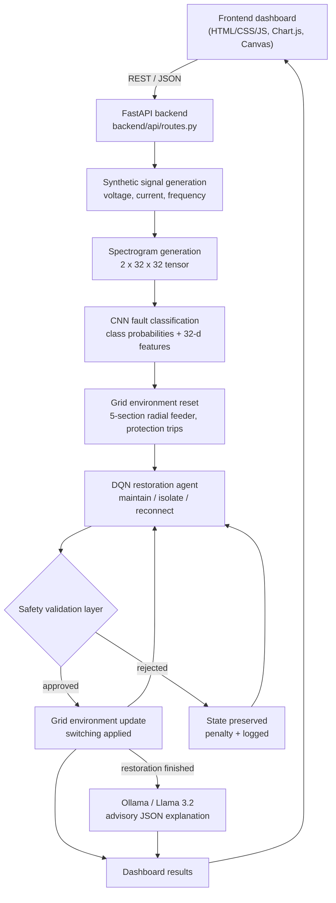

# GridMind – Intelligent Smart Grid Fault Detection and Autonomous Restoration Using CNN, DQN and Local LLM

GridMind is a simulation-based system for detecting faults in a power distribution network and restoring supply automatically. It generates synthetic voltage, current and frequency signals and turns them into spectrograms. A convolutional neural network (CNN) classifies the operating condition from those spectrograms. A Deep Q-Network (DQN) agent then chooses switching actions to restore a simulated five-section feeder, and an independent safety layer checks every action before it is carried out. A locally running Llama 3.2 model (through Ollama) writes an explanation of each restoration. Everything runs on `localhost` and is controlled from a browser dashboard.

---

## Table of Contents
1. [Project Overview](#1-project-overview)
2. [Problem Statement](#2-problem-statement)
3. [Project Objectives](#3-project-objectives)
4. [Technology Stack](#4-technology-stack)
5. [System Architecture](#5-system-architecture)
6. [Project Folder Structure](#6-project-folder-structure)
7. [Features](#7-features)
8. [CNN Fault Detection](#8-cnn-fault-detection)
9. [DQN Restoration](#9-dqn-restoration)
10. [Safety Validation](#10-safety-validation)
11. [Ollama and Llama 3.2 Integration](#11-ollama-and-llama-32-integration)
12. [Installation and Setup](#12-installation-and-setup)
13. [Running the Project](#13-running-the-project)
14. [How to Use the Dashboard](#14-how-to-use-the-dashboard)
15. [API Documentation](#15-api-documentation)
16. [Model Training](#16-model-training)
17. [Results and Evaluation](#17-results-and-evaluation)
18. [Testing](#18-testing)
19. [Limitations](#19-limitations)
20. [Future Enhancements](#20-future-enhancements)

---

## 1. Project Overview

GridMind monitors and restores a **simulated** power distribution network. It combines five parts:

| Component | Role in GridMind |
|---|---|
| **CNN (PyTorch)** | Classifies each 0.2 s signal window as *Normal*, *Voltage Sag*, *Overload* or *Fault* from a 2-channel (voltage + current) spectrogram, and exposes a 32-value feature vector |
| **DQN agent (PyTorch)** | Observes the CNN features, CNN class probabilities and the grid state, and chooses one of three actions: maintain, isolate the faulty section, or reconnect a healthy section |
| **Safety validation layer** | Checks every proposed action independently before it is executed and rejects unsafe ones (re-energising a fault, isolating a healthy section, creating a loop, …) |
| **Ollama + Llama 3.2** | Produces a structured JSON explanation of the fault and the restoration. It is **advisory only** and never controls the grid |
| **FastAPI backend + dashboard** | REST API plus a single-page monitoring dashboard (HTML/CSS/JavaScript, Chart.js and Canvas) served from the same local server |

---

## 2. Problem Statement

In a distribution network, an abnormal condition must be recognised quickly and the right switching response chosen without making things worse. GridMind models this problem on a simplified radial feeder:

- **Normal operation:** nominal 230 V RMS, 10 A RMS, 50 Hz. No action is needed.
- **Voltage sag:** a temporary voltage dip trips undervoltage protection at one section and everything downstream. Nothing is actually faulty, so the right response is to **reconnect** the tripped sections. Isolating a healthy section is unnecessary and is rejected.
- **Overload:** one section draws excessive current and is flagged abnormal. It and the sections downstream are tripped. The overloaded section must be **isolated** before the rest is reconnected.
- **Electrical fault:** a short circuit (severe voltage collapse, high current with a DC offset, frequency deviation) trips the whole feeder. The faulty section must be **isolated**, and the healthy sections **reconnected**, using the normally-open tie switch where needed.
- **Network safety:** a faulty section must never be re-energised, healthy sections must not be isolated without reason, the source must be available, and the network must stay **radial** (no loops).

The task is to detect the condition from the electrical signals, then restore as much load as possible in as few safe steps as possible.

---

## 3. Project Objectives

Each objective below is implemented in the code.

1. **Generate synthetic electrical signals** for four operating conditions (`backend/data/dataset_generator.py`).
2. **Convert the signals into spectrograms** suitable for a CNN (`backend/cnn/spectrogram.py`).
3. **Train a CNN** for fault classification and expose its intermediate feature vector (`backend/cnn/`).
4. **Implement a DQN restoration agent** with experience replay, a target network and epsilon-greedy exploration (`backend/drl/`).
5. **Validate every restoration action** through an independent safety layer (`backend/safety/validator.py`).
6. **Integrate a locally running LLM** (Ollama, Llama 3.2) to explain faults and decisions (`backend/llm/ollama_client.py`).
7. **Develop an interactive dashboard** for simulation, restoration, training and reporting (`frontend/`).
8. **Evaluate restoration performance** of the DQN against a rule-based baseline on identical scenarios (`backend/evaluation/`).

---

## 4. Technology Stack

Every entry below is used in the source code.

| Technology | Purpose in GridMind |
|---|---|
| Python 3.10+ (tested 3.11.9) | Backend, simulation, training and evaluation |
| FastAPI | REST API (`backend/api/routes.py`) and static file serving for the dashboard |
| Uvicorn | ASGI server started by `run.py` |
| Pydantic | Request/response models (`backend/api/schemas.py`) |
| PyTorch | CNN (`backend/cnn/model.py`) and DQN (`backend/drl/dqn_agent.py`) |
| CNN | Four-class fault classification from spectrograms |
| DQN | Restoration decision-making (3 actions) |
| NumPy | Signal synthesis and numerical processing |
| SciPy | `scipy.signal.spectrogram` and `scipy.ndimage.zoom` for the CNN input |
| scikit-learn | Stratified train/validation split, confusion matrix, classification report |
| Matplotlib | Saved plots and spectrogram images |
| Requests | HTTP calls to the local Ollama REST API |
| Ollama | Runs the LLM locally (`http://localhost:11434/api/generate`) |
| Llama 3.2 | Natural-language and JSON explanation of faults and restoration |
| HTML5 / CSS3 / JavaScript | Dashboard structure, cream-themed styling and interactions (no framework) |
| Chart.js 4.4.1 (bundled locally) and HTML Canvas | Charts, and the animated grid network diagram |
| Pytest (+ httpx for FastAPI's TestClient) | Automated tests (`tests/test_pipeline.py`) |

---

## 5. System Architecture

The dashboard talks to the FastAPI backend over JSON. Inside the backend, one request runs the pipeline below:

1. **Frontend dashboard** sends a request (for example `POST /api/simulate` with a fault type).
2. **FastAPI backend** routes it (`backend/api/routes.py`).
3. **Synthetic signal generation** creates 0.2 s of voltage, current and frequency at 1 kHz.
4. **Spectrogram generation** converts voltage and current into a `2 × 32 × 32` tensor.
5. **CNN fault classification** returns the class probabilities and a 32-value feature vector.
6. **Grid environment**: the five-section feeder is reset to the post-disturbance state for the simulated condition (protection trips).
7. **DQN restoration agent** (`POST /api/restore`) reads the observation (CNN features, CNN probabilities and grid state) and proposes an action.
8. **Safety validation** approves or rejects the action **before** the environment executes it.
9. **Grid environment update**: approved switching is applied, rejected actions leave the state unchanged and are penalised. Steps 7–9 repeat until restoration is complete.
10. **Ollama / Llama 3.2** (`POST /api/llm/explain`) receives the actual results and returns a JSON explanation. This is advisory only.
11. **Dashboard results**: waveforms, spectrogram, network diagram, Q-values, safety status and the report are displayed.



### Simulated distribution network

```
 S1 Main Source ── S2 Residential (30 kW) ── S3 Industrial (50 kW) ── S4 Commercial (35 kW) ── S5 Critical (25 kW)
       └──────────────────────── normally-open tie switch (alternate feed) ────────────────────────┘
```

| Condition at section *k* | Protection response in the simulation | Correct restoration |
|---|---|---|
| Normal | none | maintain |
| Voltage Sag | switch into S*k* opens, S*k* and downstream de-energised; no fault | reconnect |
| Overload | S*k* flagged abnormal; switch into S*k* opens | isolate S*k*, then reconnect |
| Fault | feeder breaker (S1–S2) opens, S2–S5 de-energised; S*k* faulty | isolate S*k*, then reconnect the healthy sections |

**DQN observation (54 values):** log1p(CNN features) [32] + CNN probabilities [4] + energised flags [5] + fault flags [5] + isolated flags [5] + served-load ratio, restoration progress and step fraction [3].

---

## 6. Project Folder Structure

```text
smart_grid_recovery/
├── run.py                      # Single entry point: trains anything missing, then starts the server
├── requirements.txt            # Python dependencies
├── README.md                   # This file
├── AUDIT_REPORT.md             # Detailed verification report from an earlier test pass
├── backend/
│   ├── main.py                 # FastAPI app: CORS, API router, static frontend and /results
│   ├── config.py               # All settings: paths, signal, CNN, DQN, Ollama and server port
│   ├── api/
│   │   ├── routes.py           # All /api/* endpoints and the in-memory session state
│   │   └── schemas.py          # Pydantic request/response models
│   ├── data/
│   │   └── dataset_generator.py # Synthetic signals (4 classes), dataset file, sample plots
│   ├── cnn/
│   │   ├── spectrogram.py      # Signals -> 2x32x32 spectrogram tensor; spectrogram images
│   │   ├── model.py            # FaultCNN (3 conv layers -> 32-d feature layer -> 4 classes)
│   │   ├── train.py            # CNN training, metrics, confusion matrix, checkpoint
│   │   └── predict.py          # predict_fault(), extract_cnn_features(), FeatureBank
│   ├── drl/
│   │   ├── environment.py      # 5-section radial grid: reset(), step(), get_state(), rewards
│   │   ├── dqn_agent.py        # Q-network, target network, epsilon-greedy, Bellman update
│   │   ├── replay_buffer.py    # Experience replay buffer
│   │   └── train.py            # Episode-based DQN training with best-checkpoint selection
│   ├── safety/
│   │   └── validator.py        # validate_action(): independent safety checks
│   ├── llm/
│   │   └── ollama_client.py    # Ollama health check, prompt, JSON parsing, saved reports
│   ├── evaluation/
│   │   ├── baseline.py         # Rule-based restoration agent
│   │   └── metrics.py          # DQN vs rule-based evaluation on identical scenarios
│   └── utils/
│       └── helpers.py          # Signal statistics (cycle RMS, status text), JSON helpers
├── frontend/
│   ├── index.html              # Dashboard layout (8 views)
│   ├── style.css               # Cream theme; all colours defined as CSS variables
│   ├── script.js               # API calls, charts, animated network canvas
│   └── assets/
│       └── chart.umd.min.js    # Chart.js 4.4.1 (local copy, no internet needed)
├── data/
│   ├── dataset.npz             # 600 synthetic samples (150 per class)
│   └── dataset_metadata.json   # Dataset parameters
├── models/
│   ├── cnn_fault_detector.pth  # Trained CNN checkpoint
│   └── dqn_agent.pth           # Trained DQN checkpoint
├── results/
│   ├── cnn_metrics.json        # CNN accuracy, history, confusion matrix, classification report
│   ├── dqn_training.json       # Episode rewards, losses, epsilon, validation scores
│   ├── evaluation.json         # DQN vs rule-based metrics (overall and per fault type)
│   ├── plots/                  # Waveforms, spectrograms, CNN curves, confusion matrix, DQN plots
│   ├── logs/                   # One JSON trajectory per restoration run (created at runtime, not in Git)
│   └── reports/                # Llama 3.2 restoration reports (.json + .md)
└── tests/
    ├── conftest.py             # Adds the project root to the import path
    └── test_pipeline.py        # End-to-end test suite
```

---

## 7. Features

### Fully implemented
| Feature | Description |
|---|---|
| **Overview** | Grid status, detected fault and CNN confidence, CNN validation accuracy, served load, restoration stage, DQN cumulative reward, live network diagram, quick-pipeline buttons and an event log |
| **Fault simulation** | Buttons for Normal, Voltage Sag, Overload and Fault, with an optional choice of affected section (2–5) |
| **Waveforms** | Voltage, current and frequency charts (200 samples each), the CNN class-probability chart and RMS-based signal status text |
| **Spectrogram view** | The current signal's voltage and current spectrograms, plus the four saved reference spectrograms |
| **Grid network view** | Animated canvas of the five sections and the tie switch (green = connected, red = faulty, orange = isolated, grey = disconnected) and a section status table |
| **CNN prediction** | Every simulation is classified by the trained CNN; `/api/classify` classifies the current or a new waveform |
| **CNN training view** | Training/validation loss and accuracy curves, confusion matrix, classification report and a *Retrain CNN* button |
| **DQN restoration** | Step-by-step animated restoration with the selected action, Q-values chart, step and cumulative reward, progress bar and trajectory table |
| **Safety validation** | Every step shows APPROVED or REJECTED with the validator's reason; rejected actions leave the grid unchanged |
| **Rule-based baseline** | *Run Rule-Based* runs the baseline on the same scenario |
| **Performance evaluation** | DQN vs rule-based bar charts, a detailed metrics table and per-fault-type results; *Re-run Evaluation* recomputes them |
| **AI Assistant** | *GENERATE AI RESTORATION REPORT* sends the real simulation results to Llama 3.2 and shows the fault explanation, possible causes, DQN justification, safety considerations, recommended sequence and grid summary. A loading indicator and an error box (for example when Ollama isn't running) are included |
| **Restoration reports and logs** | Every restoration run is saved to `results/logs/` and every LLM report to `results/reports/` (JSON + Markdown) |
| **Status indicators** | Sidebar lights for backend, CNN model, DQN model and Ollama/llama3.2, refreshed every 15 s |

### Partially implemented or with limitations
| Feature | Limitation |
|---|---|
| **Event log** | Shown on the Overview page for the current browser session only; it is not saved (restoration trajectories *are* saved in `results/logs/`) |
| **Training from the dashboard** | *Train DQN* and *Retrain CNN* work, but the request blocks until training finishes, with no live progress bar. They **overwrite** the saved checkpoints and metrics |
| **Session state** | The current scenario lives in server memory. One server holds one shared scenario, so two open browser tabs affect each other |
| **AI report speed** | Takes roughly 1.5–3 minutes on CPU (see [Results](#17-results-and-evaluation)) |

---

## 8. CNN Fault Detection

**Input representation** (`backend/cnn/spectrogram.py`): voltage and current are divided by their nominal peak values (per-unit), so sag depth and over-current magnitude are preserved. Each signal is transformed with `scipy.signal.spectrogram` (fs = 1000 Hz, 32-sample window, 28-sample overlap), converted to a log-compressed amplitude, `log1p(20·√P) / log1p(20)`, and resized with `scipy.ndimage.zoom` to 32 × 32. Stacking the two channels gives a **2 × 32 × 32** tensor.

**Architecture** (`backend/cnn/model.py`, `FaultCNN`):

```
Conv2d(2→16, 3×3) → ReLU → MaxPool(2)        32×32 → 16×16
Conv2d(16→32, 3×3) → ReLU → MaxPool(2)       16×16 → 8×8
Conv2d(32→64, 3×3) → ReLU → AdaptiveAvgPool  → 64
Linear(64→32) → ReLU                         ← 32-value feature vector (passed to the DQN)
Linear(32→4)                                 ← Normal / Voltage Sag / Overload / Fault
```

**Training** (`backend/cnn/train.py`): stratified 80/20 split (480/120), cross-entropy loss, Adam (lr 3e-3), batch size 32, and the checkpoint with the best validation accuracy is kept. Outputs: `models/cnn_fault_detector.pth`, `results/cnn_metrics.json`, the loss/accuracy curves and the confusion matrix.

**Inference API** (`backend/cnn/predict.py`):
- `predict_fault(spectrogram)` returns the class, confidence and all four probabilities.
- `extract_cnn_features(spectrogram)` returns the 32-value feature vector from the layer before the classifier.

**Result:** 97.5 % validation accuracy (see [Results and Evaluation](#17-results-and-evaluation)).

---

## 9. DQN Restoration

**Environment** (`backend/drl/environment.py`): the five-section radial feeder with a normally-open S1–S5 tie switch. It provides `reset()`, `step(action)`, `get_state()`, `calculate_reward()` and `get_network_status()`. Each episode is limited to 12 steps.

**Observation (54 values):** log1p(CNN features) [32], CNN probabilities [4], energised flags [5], fault flags [5], isolated flags [5], served-load ratio, restoration progress and step fraction [3].

**Actions:**

| Action | Meaning |
|---|---|
| 0 | Maintain the current state |
| 1 | Isolate the faulty section |
| 2 | Reconnect the next healthy section, critical load first, through the main feeder or the tie switch |

**Reward** (`calculate_reward`):
- −0.5 for every step (time penalty).
- −5 when the safety layer rejects the action.
- +5 for a valid isolation.
- +20 × the increase in served-load ratio for a reconnection, plus +3 when the critical load is restored.
- −1 for choosing *maintain* while restoration is incomplete.
- +10 when restoration completes with a valid action.

**Agent** (`backend/drl/dqn_agent.py`, `backend/drl/replay_buffer.py`):

| Setting | Value |
|---|---|
| Q-network | 54 → 128 → 128 → 3 (ReLU) |
| Experience replay | 10,000 transitions, batch 64 |
| Bellman target | r + γ · maxₐ Q_target(s′, a) · (1 − done), γ = 0.95 |
| Loss / optimiser | Smooth L1, Adam (lr 5e-4), gradient clipping 5.0 |
| Target network | synchronised every 10 episodes |
| Exploration | ε-greedy, 1.0 → 0.05 (× 0.98 per episode) |
| Training | 300 episodes; the policy with the best average reward on 40 held-out scenarios is saved |

The agent is used through `select_action(state)`, `remember(...)`, `train_step()`, `save_model()` and `load_model()`.

---

## 10. Safety Validation

`backend/safety/validator.py` provides `validate_action(action, environment_state)`, which returns `{valid, reason, corrected_action}`. `GridEnvironment.step()` calls it **for every action, before execution**. This applies to both the DQN and the rule-based agent. The validator recomputes which sections are energised from the raw switch states itself, rather than trusting the environment's bookkeeping.

| Check | Example of a rejected action |
|---|---|
| Valid action and section index | Action 5, section 7, or switching the source section |
| Source availability | Any switching while the main source is unavailable |
| No re-energising a fault | Reconnecting while a faulty section is not yet isolated (suggested correction: *isolate*) |
| Faulty sections stay out | Reconnecting a faulty or isolated section |
| No unnecessary isolation | Isolating a healthy section, for example during a voltage sag |
| Connectivity | Reconnecting from a feeder section that is not energised, or through a switch that doesn't exist |
| Radial constraint | Closing a switch that would create a loop (the energised network must stay a tree) |

When an action is rejected, the network state is preserved, the rejection is recorded in `invalid_actions`, and the agent receives a −5 reward penalty. The LLM cannot bypass this layer, because it never calls the environment.

---

## 11. Ollama and Llama 3.2 Integration

`backend/llm/ollama_client.py` connects to the locally running Ollama server.

- `check_ollama()` calls `GET http://localhost:11434/api/tags` and confirms that `llama3.2` is installed.
- `generate_explanation(context)` calls `POST http://localhost:11434/api/generate` with model `llama3.2`, `format: "json"`, temperature 0.3, up to 700 tokens, a 300 s timeout and `keep_alive: 30m`, so the model stays loaded between reports.
- **Input (actual results only):** detected fault class and CNN confidence, CNN probabilities, voltage/current/frequency status, affected section, network status, the DQN action sequence, the safety-validation results, restoration progress and served load.
- **Output (JSON):** `fault_explanation`, `possible_causes`, `dqn_action_justification`, `safety_considerations`, `recommended_restoration_sequence` and `grid_condition_summary`. Each report is saved to `results/reports/` as JSON and Markdown.
- **Error handling:** if Ollama isn't running, times out, or the model is missing, the client raises a clear error and the API returns HTTP 503 with that message. The dashboard shows it in a red error box. No hard-coded fallback text is ever substituted.
- **Advisory only:** the LLM's output is displayed and saved, but it is never passed to the DQN, the environment or the safety validator.

---

## 12. Installation and Setup

The instructions below are for **Windows PowerShell**.

### 8.1 Python environment

```powershell
cd S:\smart_grid_recovery

python --version          # must be 3.10 or newer (tested with 3.11.9)

python -m venv venv

.\venv\Scripts\Activate.ps1

pip install -r requirements.txt
```

> If PowerShell blocks `Activate.ps1`, run `Set-ExecutionPolicy -Scope CurrentUser RemoteSigned` once, then activate again.
> `pip install torch` installs the standard build from PyPI. GridMind only needs the CPU, so no GPU or CUDA is required.

### 8.2 Ollama and Llama 3.2

Ollama is a separate application, not a pip package.

1. Install Ollama for Windows from <https://ollama.com/download> (skip this if it's already installed).
2. Make sure the Ollama server is running. The desktop app starts it automatically; otherwise run:
   ```powershell
   ollama serve
   ```
3. Check whether the model is available:
   ```powershell
   ollama list
   ```
   Look for `llama3.2:latest` (about 2.0 GB). **Only if it is missing**, download it:
   ```powershell
   ollama pull llama3.2
   ```

GridMind still works without Ollama: simulation, CNN, DQN, safety validation and evaluation all run normally. Only the AI Assistant shows an error message, and the sidebar Ollama light turns red.

### 8.3 Pre-trained models

The repository already contains trained checkpoints (`models/cnn_fault_detector.pth` and `models/dqn_agent.pth`), the dataset and the saved results. **No training is needed** to run the dashboard.

---

## 13. Running the Project

```powershell
cd S:\smart_grid_recovery
.\venv\Scripts\Activate.ps1      # if you created a virtual environment
python run.py
```

`run.py` does the following:
1. Checks that the port is free and exits with a clear message if it isn't.
2. Generates the dataset or trains a model **only if** a file is missing (with the files provided, nothing is retrained).
3. Checks Ollama and prints `Ollama: llama3.2 ready` or the reason it isn't.
4. Starts Uvicorn and opens the dashboard in your browser.

**Dashboard URL:** <http://127.0.0.1:8765>
**Interactive API docs (Swagger UI):** <http://127.0.0.1:8765/docs>

| Option | Effect |
|---|---|
| `python run.py --port 9000` | Use another port, if 8765 is busy |
| `python run.py --no-browser` | Don't open the browser automatically |
| `python run.py --train` | Force full retraining before starting (see [Model Training](#16-model-training)) |
| `python run.py --train-only` | Train whatever is missing (or everything, with `--train`), then exit without starting the server |

**To stop the server**, press **Ctrl+C** in the terminal.

> The server listens on `127.0.0.1` only. If `http://localhost:8765` doesn't load in your browser, use `http://127.0.0.1:8765`.

---

## 14. How to Use the Dashboard

1. **Open the dashboard** at <http://127.0.0.1:8765>. A Fault scenario is simulated automatically on load, and the four sidebar status lights should be green.
2. **Select a condition:** in *Fault Simulation*, click **Normal**, **Voltage Sag**, **Overload** or **Fault**. You can also choose the affected section first (2–5, or random).
3. **Start the full pipeline:** on *Overview*, **▶ Run full pipeline** simulates a random disturbance (Voltage Sag, Overload or Fault) and restores it in one click. Alternatively, open *DQN Restoration* and click **Start Restoration**.
4. **Observe the CNN classification:** *Fault Simulation* shows the true condition, the CNN class (green when correct, red when wrong), the confidence and the probability chart.
5. **Observe the DQN actions:** *DQN Restoration* animates each step with the selected action, the Q-values for Maintain, Isolate and Reconnect, and the step reward.
6. **Check safety approval:** the *Safety Validation* card shows **APPROVED** or **REJECTED** with the reason for every step. The trajectory table lists all steps.
7. **Watch the grid change:** the network diagram updates after each step. Sections turn red (faulty), orange (isolated), grey (disconnected) or green (connected), and energised lines animate.
8. **Check the served load:** the progress bar and the Overview's *Served Load* card show the restored load. An isolated faulty section's load can't be restored, so served load below 100% can still be a complete restoration.
9. **Generate an AI report:** open *AI Assistant* and click **GENERATE AI RESTORATION REPORT**. The report is based on the last restoration and is saved to `results/reports/`.
10. **Review performance:** *Performance* compares the DQN with the rule-based agent on 100 identical scenarios. **Re-run Evaluation** recomputes the comparison.

### What each section shows
| Section | Content |
|---|---|
| Overview | Status cards, live network, quick pipeline, event log |
| Fault Simulation | Condition buttons, section selector, waveforms, CNN result and probabilities |
| Spectrogram | Current spectrogram (the CNN's input source) and four reference spectrograms |
| Grid Network | Large network diagram with legend and section status table |
| DQN Restoration | Train / Start Restoration / Run Rule-Based / Reset Grid, step cards, Q-values, trajectory, training reward curve |
| CNN Training | Retrain button, accuracy and loss cards, curves, confusion matrix, classification report |
| Performance | DQN vs rule-based charts and tables |
| AI Assistant | Detected fault, DQN decision, safety summary and the Llama 3.2 report |

---

## 15. API Documentation

All endpoints are under `/api` and use JSON. Swagger UI: `http://127.0.0.1:<PORT>/docs` (OpenAPI schema at `/openapi.json`).

| Endpoint | Method | Purpose |
|---|---|---|
| `/api/health` | GET | Backend, model-file and Ollama/llama3.2 availability |
| `/api/simulate` | POST | Generate a waveform for a condition, classify it with the CNN and reset the grid to that scenario |
| `/api/classify` | POST | Classify the current waveform, or a newly generated one, with the CNN |
| `/api/restore` | POST | Run the DQN restoration (every action safety-validated) on the current scenario |
| `/api/baseline` | POST | Run the rule-based agent on the current scenario |
| `/api/reset` | POST | Reset the grid to the current scenario's post-disturbance state |
| `/api/network` | GET | Current topology and section statuses |
| `/api/llm/explain` | POST | Send the actual simulation and restoration results to Llama 3.2 and return its report |
| `/api/results` | GET | Stored CNN metrics, DQN training log, evaluation, plot and report file names |
| `/api/train/cnn` | POST | Train the CNN (**overwrites** the checkpoint) |
| `/api/train/dqn` | POST | Train the DQN and optionally evaluate it (**overwrites** the checkpoint) |
| `/api/evaluate` | POST | Re-run the DQN vs rule-based evaluation (rewrites `results/evaluation.json`) |

The response examples below come from actual calls; long arrays are shortened with `…`.

### `GET /api/health`: 200
```json
{"backend": "ok", "cnn_model": true, "dqn_model": true,
 "ollama": {"available": true, "model_available": true, "models": ["…", "llama3.2:latest"], "model": "llama3.2", "error": null}}
```

### `POST /api/simulate`: 200, or 422 for invalid input, 409 if the CNN is not trained
Request (`fault_type` ∈ `Normal`, `Voltage Sag`, `Overload`, `Fault`; `section` 2–5, optional, random if omitted; `seed` optional):
```json
{"fault_type": "Fault", "section": 4, "seed": 7}
```
Response (keys `fault_type, section, waveform, stats, spectrogram_image, classification, feature_vector, network`):
```json
{"fault_type": "Fault", "section": 4,
 "waveform": {"t": [0.0, 0.001, "…"], "voltage": ["…200 values"], "current": ["…"], "frequency": ["…"]},
 "stats": {"voltage_status": "Severe collapse (min 24.9 V RMS, 0.11 pu)",
           "current_status": "Fault current (max 55.1 A RMS, 5.51 pu)",
           "frequency_status": "Severe deviation (range 48.70-51.30 Hz)", "…": "…"},
 "spectrogram_image": "data:image/png;base64,…",
 "classification": {"class_index": 3, "fault_class": "Fault", "confidence": 1.0,
                    "probabilities": {"Normal": 0.0, "Voltage Sag": 0.0, "Overload": 0.0, "Fault": 1.0}},
 "feature_vector": ["…32 values"],
 "network": {"sections": ["…"], "edges": ["…"], "served_load_ratio": 0.0, "…": "…"}}
```

### `POST /api/classify`: 200, or 400 if there is no current waveform
Request: `{}` classifies the current waveform; `{"fault_type": "Overload", "seed": 3}` generates a new one.
```json
{"true_class": "Overload",
 "classification": {"class_index": 2, "fault_class": "Overload", "confidence": 0.9997,
                    "probabilities": {"Normal": 0.0, "Voltage Sag": 0.0003, "Overload": 0.9997, "Fault": 0.0}},
 "feature_vector": [0.0, 7.824, 0.0, "…"], "correct": true}
```

### `POST /api/restore` and `POST /api/baseline`: 200, or 409 if a required model is not trained
No request body. If no scenario exists yet, a Fault scenario is simulated first (this needs the CNN). `/api/restore` also needs the DQN checkpoint; `/api/baseline` does not.
Response keys are `agent, scenario, trajectory, summary, initial_network, log_path`. One trajectory step:
```json
{"step": 1, "action": 1, "action_name": "ISOLATE FAULTY SECTION",
 "q_values": [26.28, 31.23, 22.68],
 "validation": {"valid": true, "reason": "Isolating faulty section 4 removes the fault from the network",
                "corrected_action": null, "action": 1, "action_name": "ISOLATE FAULTY SECTION"},
 "detail": "Isolated section 4 (Commercial Load)", "reward": 4.5, "cumulative_reward": 4.5,
 "complete": false, "served_load_ratio": 0.0, "progress": 0.0, "network": {"…": "…"}}
```
Summary:
```json
{"steps": 3, "served_load_pct": 75.0, "progress_pct": 100.0, "invalid_actions": 0, "cumulative_reward": 31.5, "success": true}
```
For `/api/baseline`, `agent` is `"Rule-Based"` and `q_values` is `null`.

### `POST /api/reset` and `GET /api/network`: 200
Response: `{"data": {...}}` with keys `sections, edges, source_available, served_load_ratio, progress, complete, steps, scenario`. One section and the tie switch:
```json
{"id": 4, "name": "Commercial Load", "type": "commercial", "demand": 35.0, "priority": 1, "index": 3,
 "connected": false, "fault": true, "isolated": true, "status": "isolated", "served_load": 0.0}
{"from": 1, "to": 5, "closed": true, "tie": true}
```

### `POST /api/llm/explain`: 200, or 503 if Ollama is unavailable or times out
Request: `{}` (optional `{"include_baseline": true}`). It uses the last DQN restoration, running one first if needed.
Response keys are `model, report, json_parsed, latency_s, context, report_path`. Example `report` from a saved run:
```json
{"fault_explanation": "Severe voltage collapse, fault current, and frequency deviation indicate a major fault in section S3.",
 "possible_causes": ["Overload", "Short Circuit"],
 "dqn_action_justification": "DQN chose to isolate faulty section 3, reconnect healthy sections, and utilize the tie switch for alternate feed …",
 "safety_considerations": ["Isolating faulty section removes fault from network", "Reconnecting healthy sections maintains radial network topology"],
 "recommended_restoration_sequence": ["ISOLATE FAULTY SECTION", "RECONNECT HEALTHY SECTION", "…"],
 "grid_condition_summary": "Network in severe collapse with fault current and frequency deviation; 100% restoration progress, served load at 64.3%"}
```
Error example (503): `{"detail": "Ollama is not running at http://localhost:11434. Start it with: ollama serve"}`

### `GET /api/results`: 200
`{"data": {"cnn": {...}, "dqn_training": {...}, "evaluation": {...}, "plots": ["cnn_confusion_matrix.png", "…"], "reports": ["…"]}}`

### Training and evaluation endpoints: 200, or 422 for out-of-range values
| Endpoint | Request (defaults) | Allowed range |
|---|---|---|
| `POST /api/train/cnn` | `{"epochs": 30, "regenerate_dataset": false}` | epochs 1–200 |
| `POST /api/train/dqn` | `{"episodes": 300, "evaluate": true}` | episodes 10–3000 |
| `POST /api/evaluate` | `{"episodes": 100}` | 10–1000 |

The responses are `{"data": {...}}` containing the training metrics or evaluation results.

Static files: `/` serves the dashboard and `/results/...` serves saved plots and files.

---

## 16. Model Training

> ⚠ **Retraining overwrites** `models/cnn_fault_detector.pth`, `models/dqn_agent.pth`, `results/*.json` and the plots in `results/plots/`. Back them up first if you want to keep the current results. With a fixed random seed results are similar between runs, but not guaranteed to be identical.

### Full retraining (supported by `run.py`)
```powershell
python run.py --train --train-only
```
1. Regenerates the dataset: 600 samples, 150 per class → `data/dataset.npz`, plus sample waveform and spectrogram plots.
2. Trains the CNN (40 epochs by default, batch 32, Adam lr 3e-3, best validation checkpoint kept) → `models/cnn_fault_detector.pth`, `results/cnn_metrics.json`, `results/plots/cnn_*.png`.
3. Trains the DQN (300 episodes, γ = 0.95, Adam lr 5e-4, batch 64, replay buffer 10,000, target update every 10 episodes, ε 1.0 → 0.05). The best policy on 40 held-out validation scenarios is kept → `models/dqn_agent.pth`, `results/dqn_training.json`, `results/plots/dqn_rewards.png`.
4. Evaluates DQN vs rule-based on 100 identical scenarios → `results/evaluation.json`, `results/plots/dqn_vs_rule_based.png`.

Without `--train-only`, the server starts after training. Training takes well under a minute per model on a typical CPU.

### Individual steps
```powershell
python -m backend.data.dataset_generator   # dataset + sample plots
python -m backend.cnn.train                # CNN only
python -m backend.drl.train                # DQN + evaluation
```

### From the dashboard
*CNN Training → Retrain CNN* (epochs field, default 30) and *DQN Restoration → Train DQN* (episodes field, default 300). After retraining the CNN, also retrain the DQN, because its input features change.

All settings are in `backend/config.py`.

---

## 17. Results and Evaluation

All figures below are read from the files saved in `results/`. They come from **simulated scenarios**, not real-world measurements.

### CNN fault classification (`results/cnn_metrics.json`)
The current checkpoint was trained for 30 epochs (best epoch 29) on 480 training and 120 validation samples (stratified split).

- **Validation accuracy: 97.5 %** (training accuracy 98.1 %, macro F1 0.975)

| Class | Precision | Recall | F1-score | Support |
|---|---|---|---|---|
| Normal | 0.909 | 1.000 | 0.952 | 30 |
| Voltage Sag | 1.000 | 0.900 | 0.947 | 30 |
| Overload | 1.000 | 1.000 | 1.000 | 30 |
| Fault | 1.000 | 1.000 | 1.000 | 30 |

Confusion matrix (validation; rows = true class, columns = predicted):

| | Normal | Voltage Sag | Overload | Fault |
|---|---|---|---|---|
| **Normal** | 30 | 0 | 0 | 0 |
| **Voltage Sag** | 3 | 27 | 0 | 0 |
| **Overload** | 0 | 0 | 30 | 0 |
| **Fault** | 0 | 0 | 0 | 30 |

The only errors are mild voltage sags classified as Normal. Plots: `results/plots/cnn_training_curves.png`, `results/plots/cnn_confusion_matrix.png`.

### DQN training (`results/dqn_training.json`)
- 300 episodes in about 10 s on CPU.
- Average reward over the first 20 episodes was 2.23, rising to 21.78 over the last 20.
- Success rate over the last 50 training episodes: 98 %.
- Best held-out validation reward: 22.28.
- Plot: `results/plots/dqn_rewards.png`.

### DQN vs rule-based baseline (`results/evaluation.json`, 100 identical scenarios)

| Metric | DQN | Rule-based |
|---|---|---|
| Successful restorations | 99 / 100 | 100 / 100 |
| Average restoration steps | 1.63 | 1.52 |
| Average served load | 86.6 % | 86.8 % |
| Average restoration progress | 99.8 % | 100.0 % |
| Invalid (rejected) actions | 0 | 0 |
| Average cumulative reward | 20.85 | 21.19 |

| Fault type (episodes) | DQN success / avg steps | Rule-based success / avg steps |
|---|---|---|
| Normal (27) | 100 % / 1.00 | 100 % / 1.00 |
| Voltage Sag (22) | 95.5 % / 1.50 | 100 % / 1.00 |
| Overload (33) | 100 % / 1.76 | 100 % / 1.76 |
| Fault (18) | 100 % / 2.50 | 100 % / 2.50 |

**Interpretation:** the DQN learns a safe and almost optimal restoration policy (0 invalid actions, 99 % success), but it **does not outperform** the rule-based baseline. The simplified environment exposes per-section fault indicators, so a hand-written rule is already close to optimal. The DQN's one failure was a voltage-sag scenario. Served load stays below 100 % because an isolated faulty section's load can't be restored. Plot: `results/plots/dqn_vs_rule_based.png`.

### Ollama / Llama 3.2
- 11 reports are saved in `results/reports/`, and all 11 returned valid JSON with every required field.
- Measured response time on this machine's CPU: 82–175 s per report. The request timeout is 300 s, and the model is kept loaded for 30 minutes to avoid reloading it.
- The LLM receives only the actual results (CNN class and confidence, signal status, network status, DQN actions, safety decisions, progress). Its output is displayed and saved, but never fed back into the agent, environment or validator.

---

## 18. Testing

```powershell
python -m pytest -v tests
```

`tests/test_pipeline.py` contains **11 tests**:

| Test | What it checks |
|---|---|
| `test_dataset_generation` | Dataset shape and all four classes generated |
| `test_spectrogram_shape` | Spectrogram is `2 × 32 × 32` and finite |
| `test_cnn_inference_and_features` | CNN predictions on new signals (≥ 70 % of 20 samples correct in the test; observed ~97 %), probabilities sum to 1, 32-d features |
| `test_environment_reset_step` | Fault scenario: reconnect-before-isolation rejected, isolation accepted, full restoration reached |
| `test_safety_validator` | Unnecessary isolation, invalid index, reconnecting a faulty section, loop creation and unavailable source are all rejected |
| `test_out_of_range_action_rejected_without_crash` | Invalid action numbers are rejected without changing the state |
| `test_every_action_passes_safety_layer` | Every DQN step calls the validator exactly once |
| `test_dqn_action_and_train_step` | Action selection, replay memory and one Bellman training step |
| `test_trained_dqn_and_baseline` | Saved DQN and rule-based agent run on all four conditions |
| `test_ollama_inference` | Real Llama 3.2 generation (skipped automatically if Ollama/llama3.2 is unavailable) |
| `test_api_endpoints` | Health, simulate, classify, restore, baseline, network, reset, results, dashboard page, and 422 on invalid input |

The tests don't retrain or overwrite any model. The full run takes about 2–3 minutes, mostly waiting for the Llama 3.2 call.

---

## 19. Limitations

- **Synthetic signals:** the voltage, current and frequency waveforms are generated mathematically, not measured on a real network.
- **Simplified network:** a five-section radial feeder with fixed loads and one tie switch. There is no power-flow calculation, line impedance or protection coordination.
- **CNN performance depends on the fault pattern:** severe faults and overloads are classified almost perfectly, but mild voltage sags are sometimes classified as Normal (recall 0.90 for Voltage Sag).
- **DQN vs baseline:** the DQN matches but doesn't beat the rule-based agent (99 % vs 100 % success). Its value should always be judged against that baseline.
- **LLM explanations may be inaccurate:** Llama 3.2 sometimes describes a restoration sequence that differs from what the DQN actually did. Its output is advisory only.
- **Slow local LLM:** on CPU, one report takes roughly 1.5–3 minutes.
- **Single-user session:** the server keeps one scenario in memory, shared by all open browser tabs.

---

## 20. Future Enhancements

*None of these is implemented yet.*

- Training and validating on **real-world power-system datasets** (for example PMU or relay event records).
- A **more realistic network simulation** with power flow (for example pandapower or OpenDSS), more sections, multiple feeders and distributed generation.
- **Better fault classification**: more fault types (line-to-ground, line-to-line, three-phase), noise robustness and fault location.
- **Better reinforcement learning**: Double/Dueling DQN, harder scenarios where rules are not optimal, multi-fault events.
- **Stronger safety constraints**: thermal limits, voltage limits and protection coordination checks.
- **Real-time monitoring**: streaming data input and WebSocket updates to the dashboard.

